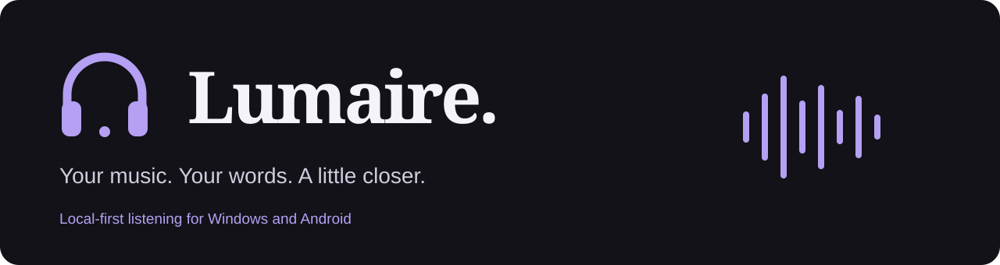
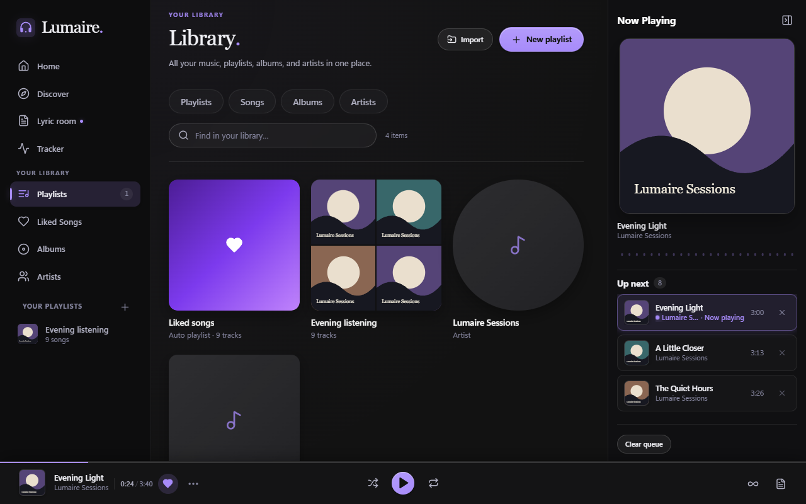
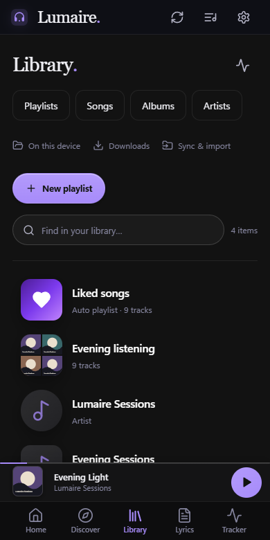

<p align="center">
  
</p>

<h1 align="center">Your music, with room for the words.</h1>
<p align="center">A local-first player for your library, online discoveries and the lyrics you love.<br />Made for Windows and Android. No Lumaire account needed.</p>

<!-- release-downloads:start -->
<p align="center"><strong>Latest release · v1.0.8</strong></p>
<p align="center">
  <a href="https://github.com/arushn47/lumaire-music-player/releases/download/v1.0.8/Lumaire_1.0.8_x64-setup.exe"></a>
  <a href="https://github.com/arushn47/lumaire-music-player/releases/download/v1.0.8/Lumaire-1.0.8-Android-arm64.apk"></a>
</p>
<p align="center">Windows x64 + WebView2 · Android 8.0+ / ARM64</p>
<p align="center"><a href="https://github.com/arushn47/lumaire-music-player/releases/download/v1.0.8/SHA256SUMS.txt">Verify checksums</a> · <a href="https://github.com/arushn47/lumaire-music-player/releases/tag/v1.0.8">What's new in v1.0.8</a> · <a href="https://github.com/arushn47/lumaire-music-player/releases">All releases</a></p>
<!-- release-downloads:end -->

<p align="center"><a href="#a-look-inside">A look inside</a> · <a href="#made-for-listening">Features</a> · <a href="#installing--updating">Install & update</a> · <a href="#build-from-source">Build from source</a></p>

## A look inside

<p align="center"></p>
<p align="center"></p>
<p align="center"><sub>Interface previews with demo tracks. No recordings are bundled.</sub></p>

## Made for listening

| Your collection, together | The words, right there |
| --- | --- |
| Local files, favorites, playlists and a playback queue. Your library stays on your device. | A dedicated lyric room with synchronized lyrics, romanization and optional translation. |
| **Something new to play** | **Carry it between devices** |
| Search artists, albums and recordings. Matching artist profiles combine only when recording evidence confirms the identity. | Share playlists, favorites and listening history between your phone and PC on the same Wi-Fi. |
| **Make it feel like yours** | **Pick up where you left off** |
| Light and dark themes, accent colors, cover art and a listening tracker. | Android saves your position when you close the app. Switching apps or locking the screen lets the music continue. |

Local files work offline. Discovery, streaming and lyric services need a connection; availability depends on the provider and recording.

## What's better in v1.0.8

- **Lyrics stay with the song.** Automatic scrolling no longer quietly pauses following.
- **Cleaner artist searches.** Fewer collaboration entries, safely combined profiles and favorites that recognize either original identity.
- **A smoother Android return.** Playback position is saved on close, and the media notification opens the app again.
- **Updates you can find.** A highlighted download action stays visible while notes scroll, with clearer playback-engine setup and retry controls.

[Read the full release notes →](https://github.com/arushn47/lumaire-music-player/releases/tag/v1.0.8)

## Installing & updating

**Windows:** open the downloaded setup EXE. Existing releases can also download the update from the update indicator or **Settings → About**, then **Restart & Update** when you are ready. WebView2 is required; the installer can download it if needed.

**Android:** open the signed ARM64 APK and confirm installation. Keep Lumaire installed to preserve your library and settings. Public updates must use the same signing certificate; a development build signed with another key cannot be upgraded with the public APK.

<details>
<summary><strong>Checksums, Windows publisher notice and platform support</strong></summary>

Windows installers do not currently have an Authenticode publisher certificate, so Windows may show an unknown-publisher warning. Check the repository and release checksums before installing; do not disable system protection globally.

```powershell
Get-FileHash .\Lumaire-1.0.8-Android-arm64.apk -Algorithm SHA256
```

Compare the result with the release's `SHA256SUMS.txt`. A checksum detects a changed download; it does not by itself prove a file is safe.

Current packages support Windows x64 and Android 8.0+ on ARM64. Linux, macOS, iOS and other Android architectures are not distributed.

</details>

<details>
<summary><strong>Online playback setup</strong></summary>

Lumaire uses free playback components, including yt-dlp and QuickJS. Setup shows download progress, verification and retry controls. Windows and Android check official stable engine updates at most daily, verify downloads and retain a fallback if an update fails. No YouTube account or browser cookies are required.

Audio formats and availability depend on platform codecs, provider access and installed components.

</details>

<details>
<summary><strong>Privacy and online services</strong></summary>

Lumaire has no required Lumaire account or analytics service. Your library, settings and listening history are stored on your device. Online services receive what they need for the feature you choose, such as search terms, track metadata or lyric text.

Optional Gemini lyric processing sends text to Google's service and needs your own configured key. Provider terms, quotas and availability apply. Review online sources and lyric processing in Settings.

Lumaire is independent and is not affiliated with Apple, Google, YouTube, JioSaavn or other catalog providers. Music, artwork and lyrics belong to their respective rightsholders. Source availability and permission to use a recording are separate questions.

</details>

## Build from source

The frontend uses React, TypeScript and Vite. Native functionality uses Tauri 2, Rust and SQLite.

For Windows, install Node.js, stable Rust, MSVC Build Tools, Windows SDK and Microsoft WebView2, then:

```powershell
git clone https://github.com/arushn47/lumaire-music-player.git
cd lumaire-music-player
npm ci
npm run desktop
```

```powershell
npm run build           # Production frontend
npm test                # Frontend/domain regression tests
npm run desktop:installer  # Local Windows NSIS installer
```

The Tauri wrapper uses the installed CLI and a project-local Cargo cache. Windows release signing is enabled only with the explicit release overlay. The [Windows release workflow](.github/workflows/windows-release.yml) builds and verifies updater artifacts; ordinary local builds do not require signing secrets.

For Android, install Android Studio, its Java runtime, Android SDK and NDK, then run `npm run android:doctor`. `npm run android:build` builds a development ARM64 APK; it is not the public release APK. Keep Android signing material private and reuse the existing release key for updates.

Before tagging a new release, run `node scripts/update-readme-downloads.mjs` after updating the app version. CI checks that the displayed version, button labels and direct download links match.

## Feedback & project information

Found a bug or have an idea? [Open an issue](https://github.com/arushn47/lumaire-music-player/issues) with your app version, platform and steps to reproduce it. Redact personal information; never include API keys, databases or signing keys.

[Release history](https://github.com/arushn47/lumaire-music-player/releases) · [Release notes](docs/RELEASE_NOTES.md) · [Third-party notices](docs/THIRD_PARTY_NOTICES.md) · [Dependency licenses](docs/THIRD_PARTY_LICENSES.txt)

<details>
<summary>About licensing</summary>

Dependency licenses apply to their respective components. This repository does not yet declare a distribution license for Lumaire's original code; no blanket open-source license is implied.

</details>
